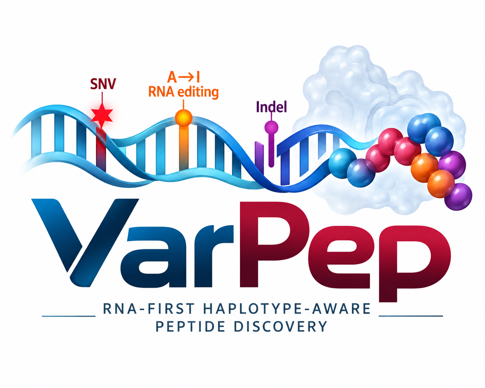
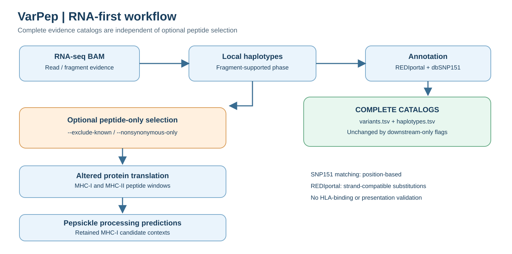
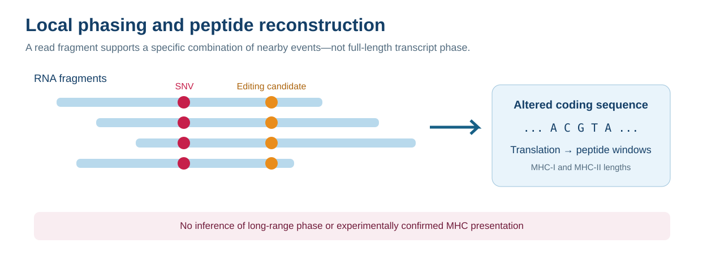
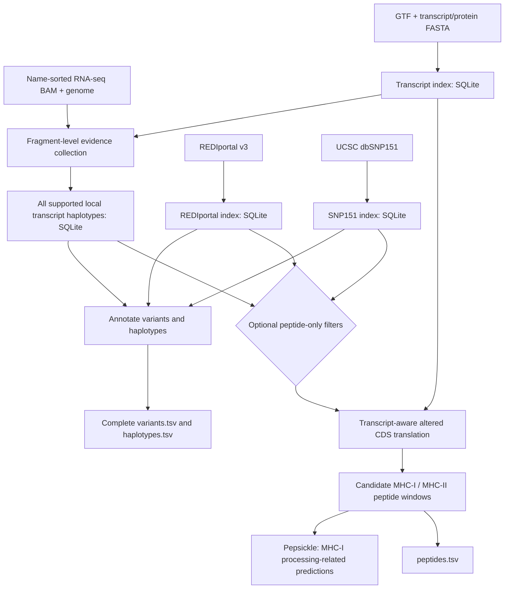

<p align="center">
  
</p>

# VarPep — RNA-supported local haplotypes and candidate peptides

VarPep is a research-oriented RNA-seq workflow for calling sequence alterations, reconstructing **fragment-supported local transcript haplotypes**, translating altered coding sequences, and generating candidate MHC-I/MHC-II peptide windows. The code does **not** establish somatic origin, bona fide RNA editing, HLA binding, MHC presentation, or immunogenicity.

## Workflow



**The variant and haplotype catalogs are always retained.** Optional selection takes place **after evidence collection and haplotype reconstruction**, restricting peptide generation and the proteins submitted to Pepsickle—not the variant or haplotype catalogs.



A local haplotype is supported by one sequencing fragment; this is not transcript-wide allelic phasing.

## Architecture



VarPep separates reusable reference/annotation indexes, parallel fragment evidence collection, persistent SQLite aggregation, transcript-aware translation, and downstream peptide processing. See [docs/ARCHITECTURE.md](docs/ARCHITECTURE.md).

## Requirements

Python 3.9+, `pysam`, a working `pepsickle` executable, an appropriately prepared **name-sorted** RNA-seq BAM, reference genome FASTA, GTF, transcript FASTA, and protein FASTA. The reference and annotation databases must use the same genome assembly (for example, GRCh38/hg38). Pepsickle must be installed separately.

```bash
python -m venv .venv
source .venv/bin/activate
pip install -r requirements.txt
python varpep.py --help
```

## Build reference indexes

```bash
python varpep.py build-index \
  --gtf gencode.annotation.gtf \
  --transcripts gencode.pc_transcripts.fa \
  --proteins gencode.pc_translations.fa \
  --index gencode_varpep.sqlite

python varpep.py build-rediportal-index \
  --rediportal TABLE1_hg38_v3.txt.gz \
  --out rediportal_v3_hg38.sqlite

python varpep.py build-snp151-index \
  --snp151 snp151.txt \
  --out snp151_hg38.sqlite
```

The REDIportal input must contain the required `Region`, `Position`, and `Strand` fields. The SNP151 builder accepts the UCSC `snp151` table format (including `bin`), **not** VCF; it indexes one-base records of class `single`. UCSC `chromStart` is zero-based, while VarPep output positions are one-based.

## Run VarPep

```bash
python -u varpep.py call \
  --bam SAMPLE.name.bam --name-sorted \
  --reference GRCh38.primary_assembly.genome.fa \
  --transcripts gencode.pc_transcripts.fa \
  --proteins gencode.pc_translations.fa \
  --index gencode_varpep.sqlite \
  --rediportal-index rediportal_v3_hg38.sqlite \
  --snp151-index snp151_hg38.sqlite \
  --out-prefix SAMPLE_varpep \
  --include-indels --min-mapq 255 --min-baseq 30 \
  --threads 8 --min-support 10 --min-vaf 0.1
```

To restrict **only peptide generation and downstream processing**, add either or both of these options to `call`:

- `--exclude-known`: excludes REDIportal-compatible A>G/T>C events and SNP151 **position-matched SNVs** from peptide generation; requires both annotation indexes. It does **not** remove these events from `variants.tsv` or `haplotypes.tsv`.
- `--nonsynonymous-only`: limits peptide generation to haplotypes whose constituent events **individually** change an encoded protein. Combinations of individually silent events with a joint protein effect are not selected by this criterion. The complete variant and haplotype catalogs remain available.

Use a **fresh `--out-prefix` for each run** to avoid reusing the SQLite run state.

## Outputs

| File | Content | Affected by peptide-only flags? |
| --- | --- | --- |
| `PREFIX.variants.tsv` | Observed variants, support, allele frequency, REDIportal/SNP151 annotations, `nonsynonymous_in_any_transcript`, `potential_neoantigen_candidate` | **No** |
| `PREFIX.haplotypes.tsv` | Supported local transcript haplotypes; ordered per-event classifications and rsIDs; `contains_potential_neoantigen_event` | **No** |
| `PREFIX.peptides.tsv` | Candidate peptide **records** and associated altered protein contexts | **Yes** |
| Pepsickle-derived peptide output | Processing-related predictions for retained MHC-I candidates | **Yes** |
| `PREFIX.counts.sqlite` | Persistent run-state database | Used internally |

The candidate flag is heuristic: it does not prove tumor specificity, somatic origin, or neoantigen presentation. See [docs/ANNOTATION_AND_FILTERING.md](docs/ANNOTATION_AND_FILTERING.md) and [docs/VALIDATION.md](docs/VALIDATION.md).

## Interpretation and limitations

- A dbSNP151 positional match is **not proof of a germline allele**, and absence from dbSNP151 is **not proof of somatic origin**. The current SNP151 lookup is **position-based**, not exact REF/ALT matching.
- REDIportal-compatible substitutions are annotated using strand-aware information where available. REDIportal absence is **not proof of tumor-specific RNA editing**; matched DNA and suitable normal controls are needed.
- A `nonsynonymous_in_any_transcript=yes` call means at least one evaluated transcript context is protein-changing; the same genomic event may have different effects in other isoforms.
- MHC-I/II candidate peptide generation is **not** HLA binding prediction. Pepsickle predicts aspects of MHC-I processing, not experimental MHC presentation.

## Validation status

Syntax and limited annotation smoke tests have been performed on the latest revision. A complete end-to-end BAM/Pepsickle benchmark and biological validation of the updated downstream-only selection **have not been performed**. Validate with a small `--region` and a fresh output prefix before production use.

## License

See [LICENSE](LICENSE).
